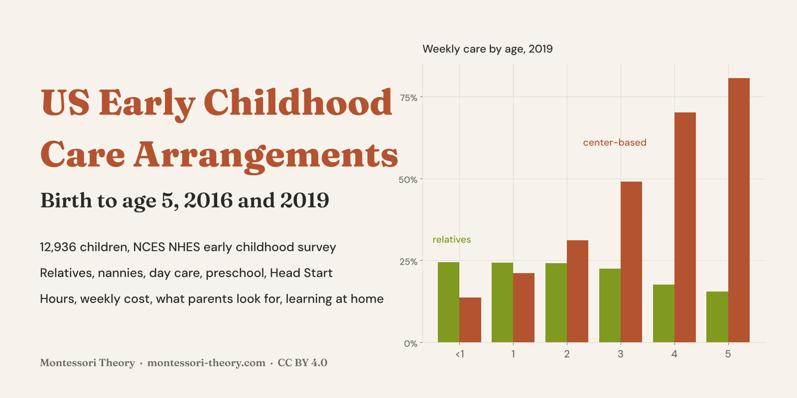
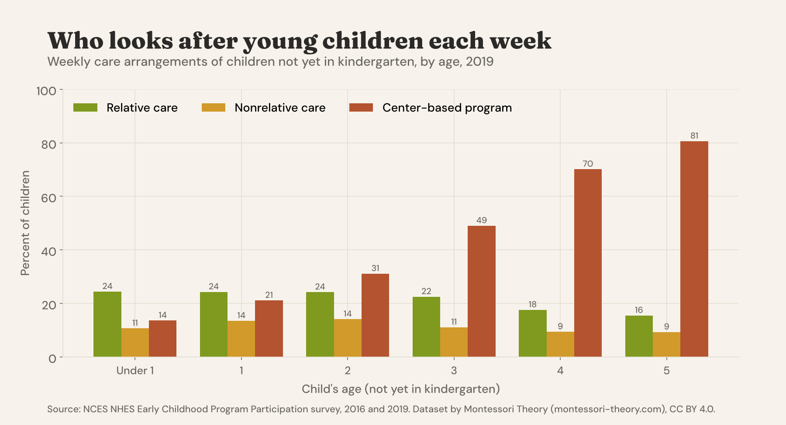
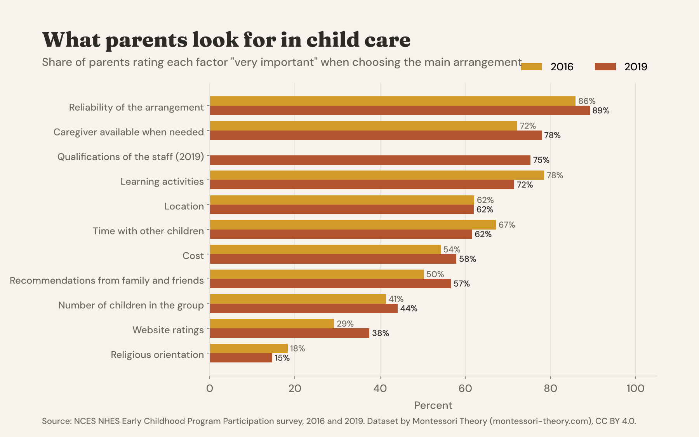
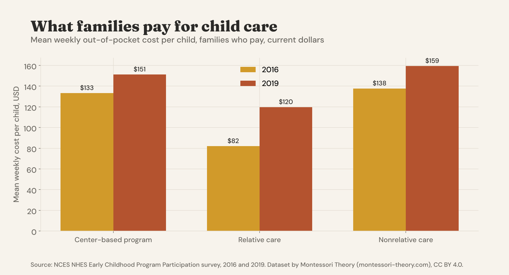
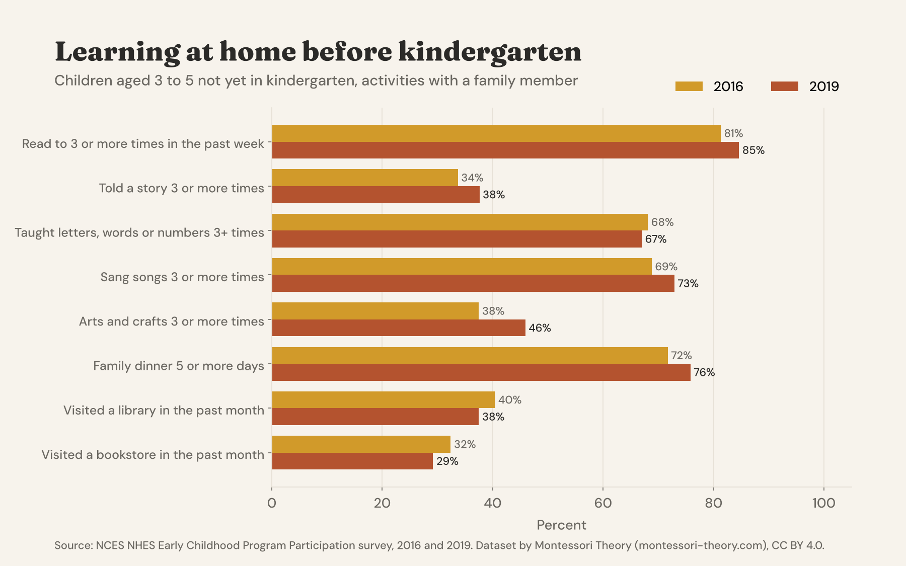

# US Early Childhood Care Arrangements, 2016 and 2019

[](https://creativecommons.org/licenses/by/4.0/) [](https://www.kaggle.com/datasets/mariamontessori/us-early-childhood-care) [](https://huggingface.co/datasets/montessoritheory/us-early-childhood-care)



**English first, version française plus bas, resumen en español al final.**

## Who Looks After Young Children, What It Costs, And What Parents Look For

Before kindergarten, who looks after American children during the week? Grandparents, a nanny, a family day care, a preschool, Head Start? How many hours, at what cost, and what matters most to parents when they choose? This dataset answers with the official source, the **Early Childhood Program Participation survey (ECPP)** of the NCES National Household Education Surveys. It puts the **2016 and 2019 public-use files** into one file of **12,936 children from birth to age 5 who are not yet in kindergarten**, with one consistent set of 76 columns in plain labels, and adds weighted national tables with standard errors.

In **2019**, **59% of young children had at least one weekly nonparental care arrangement**. **37%** attended a center-based program each week (day care, preschool or pre-K), **23%** were looked after by a relative and **12%** by a nonrelative in a home. Center care rises fast with age, from **14% of babies under 1 to 81% of 5-year-olds** not yet in kindergarten.

### The Headline Numbers, 2019

|  |  |
|---|---|
| Children with weekly nonparental care | 59.4 % (s.e. 0.9) |
| Weekly center-based program | 37.1 % of all children, 70 % at age 4 |
| Main arrangement, center-based | 32.1 % of children |
| No weekly nonparental care | 40.6 % of children |
| Mean weekly cost per child, center (families who pay) | $151, median $129 |
| Mean hourly cost, center program | $8.21 |
| Rated "very important" by parents | reliability 89 %, caregiver availability 78 %, staff qualifications 75 %, learning activities 72 % |
| Read to 3+ times in the past week (ages 3 to 5) | 85 % |
| Weekly center program at ages 3 to 5, income over $150,000 vs $40,001 to $50,000 | 83 % vs 45 % |









### Files

| file | content |
|---|---|
| `data/early_childhood_care_2016_2019.csv` | 12,936 rows, one per child (5,844 in 2016, 7,092 in 2019), 76 columns |
| `data/replicate_weights_2016_2019.zip` | the 80 NCES jackknife replicate weights per child, to compute standard errors |
| `data/weekly_care_by_age.csv` | weekly care by type, all children and by age, with standard errors |
| `data/main_arrangement.csv` | arrangement where the child spends the most hours |
| `data/weekly_cost.csv` | mean and median weekly cost per child by type of care, share paying nothing, hourly center cost |
| `data/what_parents_look_for.csv` | share of parents rating each factor very important |
| `data/home_learning_activities.csv` | reading, stories, letters, songs, crafts, dinners, library, ages 3 to 5 |
| `data/center_care_by_income.csv`, `..._by_parent_education.csv`, `..._by_race_ethnicity.csv`, `..._by_locale.csv`, `..._by_region.csv` | weekly center program at ages 3 to 5 by group |
| `data_dictionary.csv` | every column of every file, with the NCES source variable |
| `scripts/` | the code that rebuilds everything from the NCES files |
| `notebooks/starter.ipynb` | a starter notebook with weighted estimates and charts |

### Main Columns

| group | columns |
|---|---|
| Child and family | `survey_year`, `child_age`, `child_sex`, `child_race_ethnicity`, `census_region`, `locale`, `parent_education`, `household_income`, `family_type`, `parent1_work_status`, `home_language` |
| Care arrangements | `weekly_care`, `weekly_relative_care`, `weekly_nonrelative_care`, `weekly_center_program`, `main_arrangement`, hours by type, `total_care_hours`, `center_head_start`, `center_location`, `center_type_2016` |
| Cost | amount, period and children covered for each type, plus a derived `..._cost_weekly_per_child` in USD |
| Choosing care | `good_choices_available`, `difficulty_finding_care`, `main_difficulty`, `main_reason_for_care`, eleven `importance_...` columns |
| Learning at home | `times_read_to_past_week`, `told_story_past_week`, `taught_letters_words_numbers_past_week`, `sang_songs_past_week`, `arts_and_crafts_past_week`, `family_dinners_past_week`, `library_visit_past_month`, `books_owned` |
| Early skills (3 and older) | `recognizes_letters`, `counts_up_to`, `writes_first_name` |
| Weight | `final_weight` |

### Load It

```python
import pandas as pd

base = "https://raw.githubusercontent.com/montessoritheory/us-early-childhood-care/main/data"
kids = pd.read_csv(f"{base}/early_childhood_care_2016_2019.csv")

# weighted share of children with weekly center-based care, by year
kids.assign(center=kids.weekly_center_program.eq("Yes") * kids.final_weight) \
    .groupby("survey_year").apply(lambda g: 100 * g.center.sum() / g.final_weight.sum())
```

Always use `final_weight` for estimates. For standard errors, merge `replicate_weights_2016_2019.zip` on `survey_year` and `child_id` and use the 80 jackknife (JK1) replicates, SE = sqrt(79/80 × Σ (estimate_r − estimate)²). The starter notebook does both.

### How It Was Built

The ECPP public-use CSV files and codebooks for 2016 and 2019 were downloaded from the [NHES data products page](https://nces.ed.gov/nhes/dataproducts.asp) in November 2026. Each variable was mapped from the codebook of its own year, because some codes changed between waves (the cost period, the main reason for care, the difficulty item), so every value is stored as a plain label rather than a code. Weekly cost per child is derived from the amount, the period, the hours or days in care and the number of children the amount covers; nothing else was imputed beyond the imputations NCES already made. `scripts/build_ecpp.py` builds the main file and `scripts/make_outputs.py` the tables and charts.

### Checked Against The Source

- **The weekly care rates match the NCES table.** For 2019 the rebuilt estimates give 59 % of children with at least one weekly nonparental arrangement and, among them, 38 % in relative care, 20 % in nonrelative care and 62 % in center-based care, the exact figures in [NCES, Early Childhood Program Participation 2019, weekly child care arrangements](https://nces.ed.gov/nhes/tables/childcare-2019.asp).
- **Totals.** The final weights sum to 21,437,946 children in 2016 and 21,242,044 in 2019, the weighted totals printed in the NCES codebook of each file.
- Every summary table is computed from the main file with the final weight, and its standard errors from the replicate weights.

### Read With Care

- **Children not yet in kindergarten.** The survey covers children from birth to age 6 who are not yet in kindergarten. A 5-year-old already in kindergarten is not in the file.
- **Survey estimates.** Use the weights. Small groups (for example one income group at one age) have large standard errors, and the `sample_size` column tells you how many children are behind each estimate.
- **Self-reported costs.** Costs are what parents report paying out of pocket, in current dollars, after any subsidy. They are not the full price of care.
- **Items that changed.** `center_type_2016` exists only in 2016, staff qualifications only in 2019, and the religious item was reworded (`center_run_by_religious_group_2016` vs `center_teaches_religion_2019`). In 2019 "did not look for care" comes from a separate question.
- **Public files.** NCES perturbs and imputes some values in the public-use files to protect respondents, so tiny differences with published tables are expected.
- **No Montessori item.** The survey does not ask whether a program is Montessori. For Montessori private schools, see our [US Montessori Private Schools](https://github.com/montessoritheory/us-montessori-private-schools) dataset, and for what Montessori looks like from 3 to 6, our guide to [Montessori for preschoolers](https://www.montessori-theory.com/montessori-preschoolers/).

### License And Citation

**[CC BY 4.0](https://creativecommons.org/licenses/by/4.0/)**. Use it, share it and adapt it, commercially or not, and credit **Montessori Theory** with a link to **[montessori-theory.com](https://www.montessori-theory.com/)**, along with the original source below.

```bibtex
@misc{montessoritheory_us_early_childhood_care_2026,
  title  = {US Early Childhood Care Arrangements, 2016 and 2019},
  author = {Carter, Sophia and {Montessori Theory}},
  year   = {2026},
  url    = {https://github.com/montessoritheory/us-early-childhood-care},
  note   = {Dataset, version 1.0, built from the NCES NHES Early Childhood Program Participation survey}
}
```

Source. U.S. Department of Education, National Center for Education Statistics, National Household Education Surveys Program, [Early Childhood Program Participation survey](https://nces.ed.gov/nhes/), public-use data files, 2016 and 2019. US government work, public domain.

Also on **[Kaggle](https://www.kaggle.com/datasets/mariamontessori/us-early-childhood-care)**, with a starter notebook, and on **[Hugging Face](https://huggingface.co/datasets/montessoritheory/us-early-childhood-care)**, ready for the `datasets` library.

---

## Version Française

### Les modes de garde des jeunes enfants aux États-Unis, 2016 et 2019

Ce jeu de données rassemble les fichiers publics 2016 et 2019 de l'enquête officielle **NCES Early Childhood Program Participation** : **12 936 enfants de 0 à 5 ans** pas encore entrés en maternelle (kindergarten), avec le mode de garde, les heures, le coût, les critères de choix des parents et les activités d'apprentissage à la maison.

- En 2019, **59 %** des jeunes enfants avaient au moins un mode de garde hebdomadaire hors parents, et **37 %** fréquentaient chaque semaine une structure collective (crèche, preschool, pré-K).
- La fiabilité (89 %), la disponibilité de la personne (78 %) et la qualification du personnel (75 %) sont les critères jugés « très importants » par le plus de parents.
- Une structure collective coûte en moyenne **151 $ par semaine et par enfant** aux familles qui paient.

Licence CC BY 4.0, en citant **Montessori Theory** avec un lien vers **[montessori-theory.com](https://www.montessori-theory.com/)** et la source NCES.

### 🇪🇸 Resumen

Los archivos públicos 2016 y 2019 de la encuesta oficial NCES Early Childhood Program Participation: 12.936 niños de 0 a 5 años que aún no van al kindergarten, con el tipo de cuidado, las horas, el costo y lo que buscan los padres. En 2019, el 59 % tenía al menos un cuidado semanal fuera de los padres. Licencia CC BY 4.0.

---

**Part of [Montessori Open Data](https://github.com/montessoritheory/montessori-open-data)**, documented open datasets on Montessori schools and early childhood, by [Montessori Theory](https://www.montessori-theory.com/).
